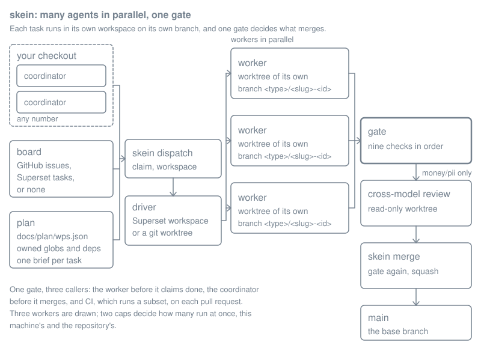
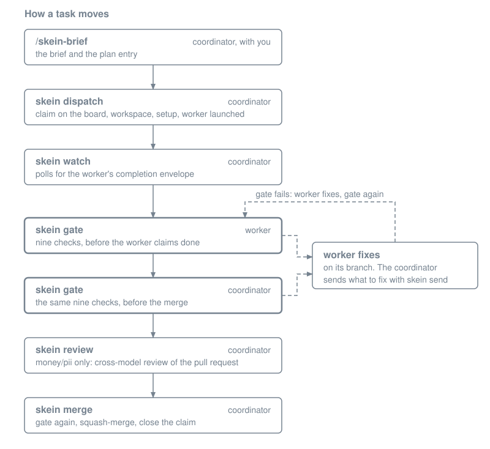

# skein

A skein is a flock of geese in flight. They fly in a V and rotate the lead as it tires, so
there is no fixed leader, only whoever is in front right now. skein runs a repo that way:
many coding agents in parallel, each in its own worktree, under any number of coordinators,
with one merge gate that decides what is done.

It packages the swarm setup that grew across several repos (a Superset workspace per task,
a coordinator that briefs and gates, workers that never merge) into a kit you install once
and vendor into each repo, the way gstack does.



## Why it exists

In March 2026 an AI QA agent, with its own GitHub account, ran for 15 days against four
repositories of a production codebase. It opened 21 fix pull requests. Six were merged, one of
them taking test coverage on a core service from 42% to 90% and adding CI coverage gates. The
other 15 were closed. The closed ones are the reason for the rule the rest of this kit is
built around. A worker's claim is not evidence.

## What you get

- **A gate.** `skein gate <ID>` runs nine checks in order: the task has a brief, the tree is
  clean, every changed file is the task's to change, no credential reached a commit, no test
  was weakened and no shared suite shrank, your repo's own invariants hold, then your standard
  commands, an optional e2e suite, and the task's acceptance commands. The worker runs it
  before claiming done, the coordinator runs it before merging, and CI runs a subset of it on
  every PR. Vendored and coordinator-owned, so a worker cannot weaken the gate it is judged
  by.
- **A plan.** `docs/plan/wps.json` is the task DAG: each task's `owned` globs, `deps`,
  `accept` commands, and money/pii flags. `skein plan` prints what is ready and which ready
  tasks overlap. Parallelism stays safe as long as no two running tasks own the same file.
- **A board.** Claims live on GitHub issues (the default outside local mode), Superset tasks,
  or nowhere for a solo run. Assigning yourself is the claim. Any number of coordinators, no
  fixed owner.
- **Two caps.** Your machine's (`~/.skein/config.json`, default 3) and the repo's
  (`.skein/config.json`, default 6), the second counted across all coordinators through the
  board. A dispatch has to fit under both.
- **Drivers.** Superset (workspaces, agents, terminals through its CLI) or local (git
  worktrees plus Claude Code headless), behind one interface.
- **Commands and skills.** `skein init|upgrade|doctor|plan|brief|dispatch|watch|status|send|
  gate|review|merge`, and Claude Code skills that wrap the judgment parts: `/skein-init`,
  `/skein-brief`, `/skein-coordinate`, `/skein-gate`, `/skein-status`.

## Quickstart in 60 seconds

```bash
git clone https://github.com/bayological/skein ~/.claude/skills/skein
~/.claude/skills/skein/setup        # registers the skills, links ~/.local/bin/skein
```
Every command needs `git`, `node` and `jq`. `gh` serves the GitHub board and pull requests,
so `skein review` and `skein merge` need it outside local mode. Superset's CLI serves the
Superset board and the Superset driver, and that driver also needs the Superset app running
on this machine. `codex` is for cross-model reviews and falls back to Claude. The installer
checks `git`, `node`, `jq` and `gh`, and prints a note for a missing one rather than
stopping.

Then run the example in a throwaway copy. A copy with no origin remote is in local mode: no
board, no pull requests, nothing pushed.

```bash
sandbox=$(mktemp -d)
cp -R ~/.claude/skills/skein/examples/hello-swarm/. "$sandbox"/
cd "$sandbox"
git init -q -b main
git add -A && git commit -qm "example: hello-swarm"
skein init --name hello-swarm --prefix HS
git add -A && git commit -qm "chore: skein init"
skein plan
```

`skein plan` prints three tasks: two ready, owning different files and dispatchable together,
and a third waiting on both. One of the ready pair carries a trap, and the gate catches it.
The walk-through and the clean-up are in [examples/hello-swarm](examples/hello-swarm).

## Set a repo up

```bash
cd your-repo
skein init                          # or the /skein-init skill, which also interviews you
```
This writes `.skein/config.json`, vendors the runtime into `scripts/skein/`, and adds
`AGENTS.md`, `docs/plan/` (runbook, coordinator prompt, onboarding, the plan), a CI
workflow, a pre-push hook that refuses the base branch, and Superset lifecycle scripts.
Every run copies the vendored runtime afresh and re-renders the pre-push hook, and it adds
its line to `.gitignore` and the runtime glob to `knip.json` when they are missing. The
templates it rendered before are left alone. In local mode it writes no CI workflow. Fill
in the project rules, commit, push.

Day to day nobody types these commands. You open a session in your checkout, paste
`docs/plan/COORDINATOR-PROMPT.md`, and talk. The coordinator runs the commands.


One wave of a swarm in the example repository, about 70 seconds of terminal: `skein plan`,
two dispatches, both workers reporting done, the gate failing HS-02 because it deleted the
two tests its change broke, `skein send` with the failure, then two merges. Worker commits
scripted for the recording. [docs/demo/README.md](docs/demo/README.md) explains how, and the
two stand-ins that keep the run off the network.

## How a task moves

```
/skein-brief  ->  docs/plan/briefs/<ID>.md + plan entry      (coordinator, with you)
skein dispatch    claim on the board, workspace, setup, worker launched
skein watch       the worker's completion envelope
skein gate        static checks, standard, e2e, accept        (worker, then coordinator)
skein review      cross-model review in a read-only worktree  (money/pii tasks)
skein merge       gate again, squash-merge, close the claim, delete the workspace
```



## Local mode

For experiments that live on one machine: a repo with no `origin` remote (or `"mode": "local"`
in `.skein/config.json`) runs without GitHub. `skein init` there sets `mode: local` and
`board: none`, and skips the CI workflow. Workspaces fork from the local base branch, so
commit briefs and the plan there before dispatching. Workers commit on their branch and stop:
no push, no PR. `skein merge` reruns the gate in the worktree, squash-merges the branch into
the base branch in your checkout as `<type>: <title> (<ID>)`, deletes the workspace and
branch, and marks the plan done, all without pushing; it refuses unless that base branch is
checked out and clean. `skein review` writes its findings, with the marker `skein merge` wants
for money/pii tasks, to `docs/plan/reviews/<ID>.md`. `--no-gate` is refused (there is no CI).
Push the whole repo by hand when you want it on GitHub; to leave local mode, add the remote
and drop `"mode"`.

## Config

`.skein/config.json` (repo, committed):

| key | what |
|---|---|
| `name`, `prefix` | project name; task ids are `<prefix>-NN` |
| `mode` | `local` for a repo with no remote (see Local mode); absent otherwise |
| `board` | `{type: github\|superset\|none, repo}`; `none` in local mode |
| `driver` | `{type: superset\|local}` |
| `maxAgents` | repo cap (default 6), counted across coordinators |
| `standard`, `e2e` | commands the gate runs |
| `install` | the install command, rendered into CI and the setup script by `skein init` |
| `invariants` | `[{name, pattern, except, message}]`: added lines matching `pattern` outside `except` fail |
| `monotonic` | `[{file, pattern}]`: the count may never fall (shared suites only grow) |
| `secretPatterns`, `secretAllow` | extra key patterns; known dev keys to ignore |
| `worker`, `review` | model policy |
| `workerPrompt` | override the fixed worker prompt (`{ID}`, `{NAME}`, `{BRIEF}`, `{GATE}`, `{BASE}`) |

The table covers the main keys. [docs/facts/FACTS.md](docs/facts/FACTS.md) lists every key the
code reads, with the line that reads it.

`~/.skein/config.json` (per machine): `{"maxAgents": 3}`, and optionally
`projects: {"<repo path>": {"supersetProjectId": "…"}}`. `SKEIN_MAX_AGENTS`,
`SKEIN_PROJECT_ID` and `SKEIN_DRIVER` override per shell, and the fact sheet lists the rest.

## Principles

- **A worker's claim is not evidence.** The gate is, plus a human or a different model
  reading the diff.
- **Ownership is the lock.** Two tasks never own one file at the same time.
- **The board is the other lock.** Assigning yourself is the claim; an assigned task is not
  yours.
- **Everything is on disk or on the board.** A new coordinator resumes from the plan, the
  briefs, and `skein status`. Sessions end; the record does not.
- **Workers never merge, never poll GitHub, never run a skill.** Their gate is the gate.

## Upgrading

```bash
skein upgrade        # in a repo: resyncs scripts/skein/, leaves config, plan and briefs alone
```
It pulls the kit checkout first, unless `SKEIN_KIT_GIT` is set, and warns rather than stopping
when the pull fails.

## Limitations

Every command needs `git`, `node` and `jq`; the GitHub board and pull requests need `gh`, the
Superset board and the Superset driver need Superset's CLI with the Superset app running on this
machine, and cross-model review falls back to a Claude model when `codex` cannot run. The secrets
and test-integrity checks match fixed lists of key shapes and weakener tokens, so a credential or
a gutted test shaped like none of them passes. Both read every added line of every file, so a
line of prose that spells out one of those tokens fails the gate the way code does. `skein plan`
reports ownership overlaps among ready tasks, and nothing refuses a dispatch of two tasks that
overlap; the gate's default base is `origin/main`, or `main`, whatever `baseBranch` says.
[docs/limitations.md](docs/limitations.md) has the rest, each line traced to the fact sheet.

MIT.
