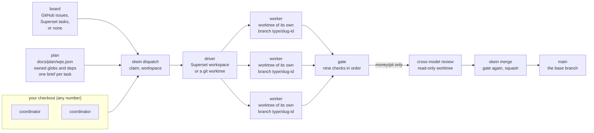

# Architecture diagram

`architecture.svg` draws how one repository runs under skein: who holds the plan, what claims
a task, where a worker runs, and what has to pass before anything reaches the base branch.
The flowchart below has the same nodes and edges as the SVG, and the key gives the line of
`docs/facts/FACTS.md` behind every label.

## Source

Three worker lanes are drawn because three fit; the number that runs at once is decided by
the two caps, not by the diagram.

## Key

Every label, with the line of `docs/facts/FACTS.md` it comes from.

| node or label | what it stands for | source |
|---|---|---|
| `your checkout`, `any number` | the repository checkout a coordinator works from; claims are checked twice because nothing is atomic across coordinators | `docs/facts/FACTS.md:298` |
| `coordinator` (two boxes) | the coordinator is one of the gate's three callers, and a board of type `none` is the single-coordinator case | `docs/facts/FACTS.md:140`, `docs/facts/FACTS.md:305` |
| `board` | where a claim lives | `docs/facts/FACTS.md:295` |
| `GitHub issues,` | the default board outside local mode: one issue per task, assigning yourself is the claim | `docs/facts/FACTS.md:295` |
| `Superset tasks,` | the Superset board: one task per skein task, assigned to the claiming user | `docs/facts/FACTS.md:301` |
| `or none` | the no-board case: every function is a no-op and the running count comes from the driver | `docs/facts/FACTS.md:305` |
| `plan` | the task DAG, read-only to the worker | `docs/facts/FACTS.md:221` |
| `docs/plan/wps.json` | the plan file by default | `docs/facts/FACTS.md:221` |
| `owned globs and deps` | two of the task fields the code reads | `docs/facts/FACTS.md:223` |
| `one brief per task` | the `brief` field names the file, and `/skein-brief` writes it | `docs/facts/FACTS.md:79`, `docs/facts/FACTS.md:223` |
| `skein dispatch` | claims the task on the board, creates the workspace, waits for setup and launches the worker | `docs/facts/FACTS.md:90` |
| `claim, workspace` | the first two of those four steps | `docs/facts/FACTS.md:90` |
| `driver` | the layer that makes and drives a workspace | `docs/facts/FACTS.md:312` |
| `Superset workspace` | the Superset driver: a workspace is a Superset worktree, the agent runs in a Superset terminal | `docs/facts/FACTS.md:312` |
| `or a git worktree` | the local driver: a workspace is a git worktree and the worker is Claude Code headless | `docs/facts/FACTS.md:321` |
| `worker` (three lanes) | the agent `skein dispatch` launches for one task | `docs/facts/FACTS.md:90` |
| `worktree of its own` | a workspace is a worktree either way, Superset's or git's | `docs/facts/FACTS.md:312`, `docs/facts/FACTS.md:321` |
| `branch <type>/<slug>-<id>` | the branch name the plan's `type` and `slug` give, with the id lowercased | `docs/facts/FACTS.md:225` |
| `gate` (thicker box) | the merge gate for one task | `docs/facts/FACTS.md:140` |
| `nine checks in order` | brief, clean-tree, boundary, secrets, test-integrity, invariants, standard, e2e, accept | `docs/facts/FACTS.md:188` |
| `cross-model review` | a different model reviews the pull request | `docs/facts/FACTS.md:340` |
| `read-only worktree` | the review worktree is forked from the branch and read-only | `docs/facts/FACTS.md:340` |
| `money/pii only` | the review is mandatory for tasks marked `money` or `pii`, and for nothing else | `docs/facts/FACTS.md:340` |
| `skein merge` | reruns the gate in the worker's worktree, squash-merges, closes the claim, deletes the workspace and then the branch | `docs/facts/FACTS.md:171` |
| `gate again, squash` | the first two of those steps | `docs/facts/FACTS.md:171` |
| `main`, `the base branch` | the base branch, `main` by default | `docs/facts/FACTS.md:171`, `docs/facts/FACTS.md:255` |
| footnote: three callers | the worker before it claims done, the coordinator before it merges, and CI | `docs/facts/FACTS.md:140` |
| footnote: CI runs a subset | on a pull request CI runs seven of the checks, leaving out clean-tree and e2e | `docs/facts/FACTS.md:213` |
| footnote: two caps | the machine cap and the repository cap, and a dispatch must fit under both | `docs/facts/FACTS.md:331`, `docs/facts/FACTS.md:332`, `docs/facts/FACTS.md:333` |

## Drawing rules

Kept so the file can be edited without breaking where it renders.

- Self-contained: no `<image>`, no `<script>`, no `<foreignObject>`, no external reference and
  no web font. Text uses the system sans-serif stack.
- Readable on both GitHub themes: no background rectangle, every box filled `none`, and every
  stroke and every text fill `#768390`, which reads on white and on GitHub's dark `#0d1117`.
- Neutral: the gate is the one box drawn with a 2.5px stroke; everything else is 1.5px.
- `width="800"` with a viewBox 800 units wide. Titles 16px, body 14px, notes 13px.
- Arrowheads are stroked chevrons rather than markers, so nothing depends on a definition
  being honoured by a viewer.
