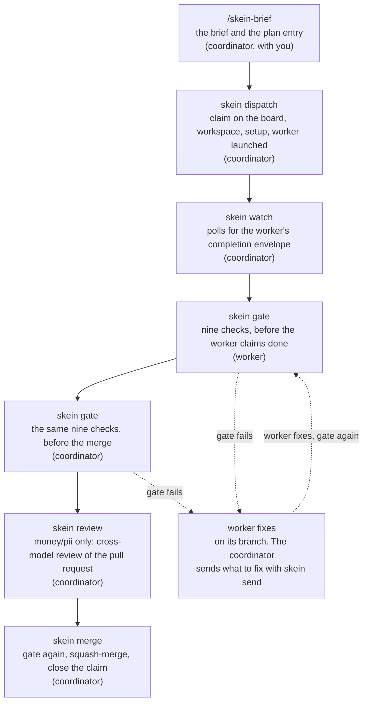

# Task lifecycle diagram: source

`lifecycle.svg` draws how one task moves through skein, from the brief the coordinator writes
with you to the squash-merge, with the gate's two steps marked by a thicker border. The dashed
path on the right is the failure loop the text block in the README cannot show: a gate failure
sends the task back to the worker, which fixes it and runs the gate again.

The SVG is hand-written and kept in step with the Mermaid source below. Change one, change the
other.

## Mermaid source

## Key

Every label traces to the fact sheet. Line numbers are `docs/facts/FACTS.md` at commit 343ca8d.

| box | label it carries | source |
|---|---|---|
| `/skein-brief` | the brief and the plan entry, written by the coordinator with you | `docs/facts/FACTS.md:79` |
| `skein dispatch` | claim on the board, workspace, setup, worker launched | `docs/facts/FACTS.md:90` |
| `skein watch` | polls for the worker's completion envelope | `docs/facts/FACTS.md:108` |
| `skein gate` (worker) | nine checks, before the worker claims done | `docs/facts/FACTS.md:140`, `docs/facts/FACTS.md:188` |
| `skein gate` (coordinator) | the same nine checks, before the merge | `docs/facts/FACTS.md:140`, `docs/facts/FACTS.md:188` |
| `skein review` | money/pii only: cross-model review of the pull request | `docs/facts/FACTS.md:154`, `docs/facts/FACTS.md:340` |
| `skein merge` | gate again, squash-merge, close the claim | `docs/facts/FACTS.md:171` |
| worker fixes | the worker fixes on its branch; the coordinator sends what to fix with `skein send` | `docs/facts/FACTS.md:132`, `docs/facts/FACTS.md:140` |
| the dashed loop | gate fails: worker fixes, gate again | `docs/facts/FACTS.md:214` |

The gate's own result line reports `status=PASS` or `status=FAIL`, and the loop turns on that
result (`docs/facts/FACTS.md:214`). A worker runs the gate before it claims done and the coordinator
runs it again before it merges, so both have a failing branch (`docs/facts/FACTS.md:140`).

## House style

The diagram shares its visual language with `architecture.svg`: `#768390` for every stroke and
every text fill, no background rectangle and no box fill, so it reads on GitHub's light and dark
themes; `rx="6"` boxes; 1.5px strokes, with 2.5px on the two gate boxes; 16px titles at
font-weight 600 and 14px body text in `ui-sans-serif, -apple-system, 'Segoe UI', Helvetica,
Arial, sans-serif`; dashed strokes for the failure loop. No embedded images, no scripts, no
web fonts, no external references.
